# Hi, I'm Hanlin 👋

🎓 CS student at UQ  
💻 Interested in C, Python and web development  
🌱 Currently learning data structures and systems programming  
🚀 You can also call me **Sputnik**  
📫 Email me at `qq1149384952 [at] gmail.com`

## 🔨 Recently working on

<!--RECENT:START-->
- [musicloud](https://github.com/blacksheep81/musicloud) — macOS-first local and cloud music player. OneDrive and Google Drive planned. · 2026-11-10
- [ui-design-toolkit](https://github.com/blacksheep81/ui-design-toolkit) — UI design skill with a five-step workflow, 20 design principles, resource catalog and source references · 2026-11-10
- [valorant-montage-director](https://github.com/blacksheep81/valorant-montage-director) — Valorant montage editing Agent Skill: five creative styles, prompts, and reference-aware workflows for everyday players. · 2026-11-10
- [capri-codex-adapter](https://github.com/blacksheep81/capri-codex-adapter) — Unofficial Capri source animation preview and Codex pet candidate packaging tools. No character assets redistributed. · 2026-11-10
- [stop-slop](https://github.com/blacksheep81/stop-slop) — Chinese and English writing skill for natural prose, author voice, and faithful editing · 2026-11-06
<!--RECENT:END-->

<picture>
  <source media="(prefers-color-scheme: dark)" srcset="https://raw.githubusercontent.com/blacksheep81/blacksheep81/output/github-snake-dark.svg">
  <source media="(prefers-color-scheme: light)" srcset="https://raw.githubusercontent.com/blacksheep81/blacksheep81/output/github-snake.svg">
  
</picture>

<picture>
  <source media="(prefers-color-scheme: dark)" srcset="https://raw.githubusercontent.com/blacksheep81/blacksheep81/output/breakout-dark.svg">
  <source media="(prefers-color-scheme: light)" srcset="https://raw.githubusercontent.com/blacksheep81/blacksheep81/output/breakout-light.svg">
  
</picture>
